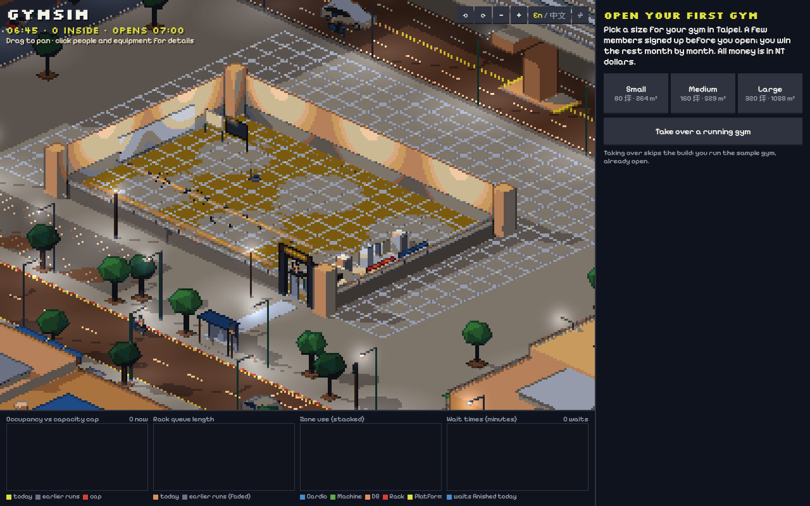
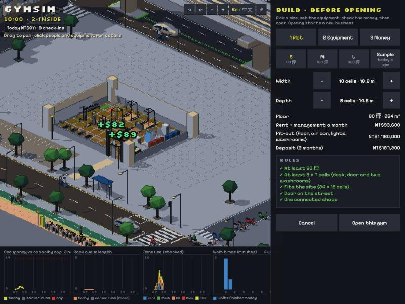
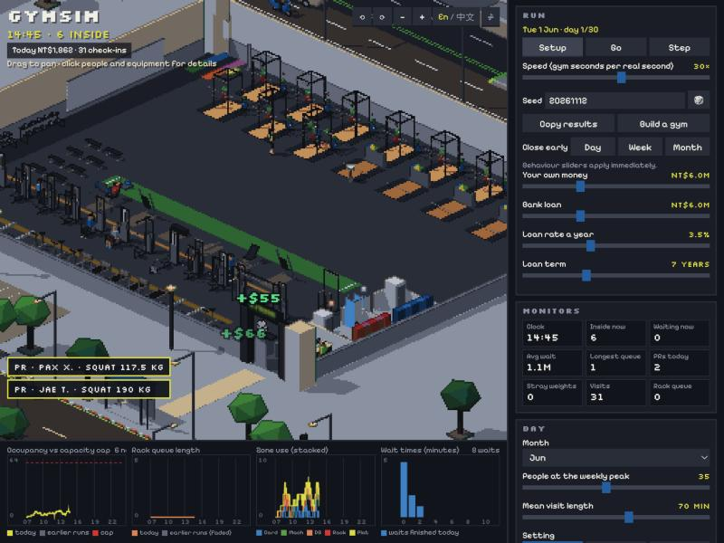
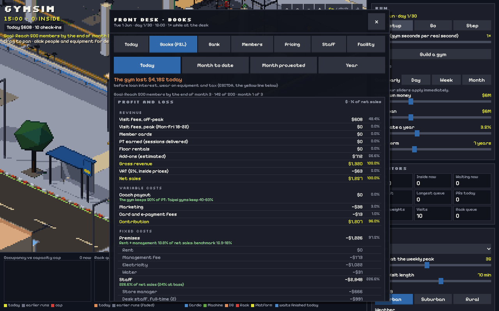
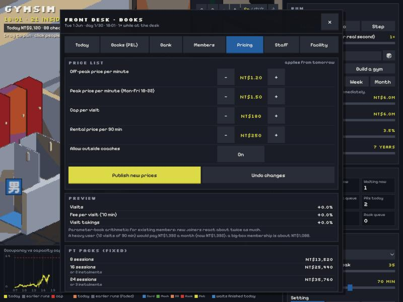
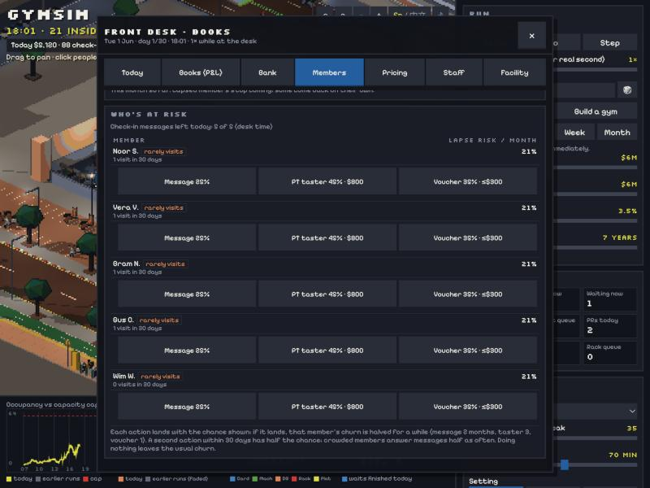
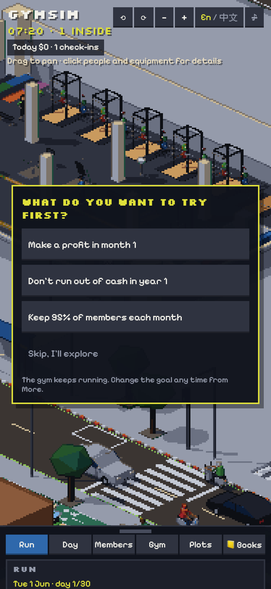
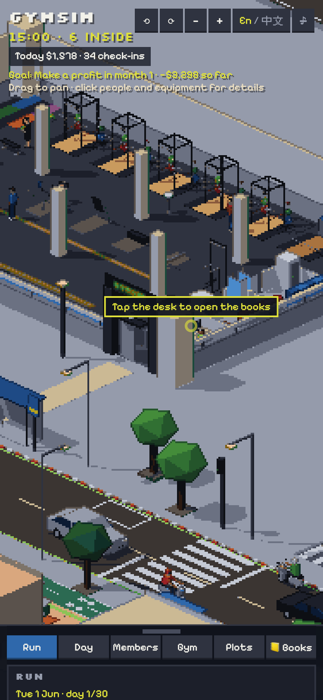

# GYM-SIM

A pixel-art isometric sandbox for people who want to understand what it takes to run a strength gym, especially the money side. You build a gym in Taipei, open the doors, and watch simulated members arrive, queue, lift and pay. Then you change something and see why the profit and loss moved.

**Play it in your browser: https://yyoyochen.github.io/gym-sim/**

Works on desktop and phones. Use the **En / 中文** button to switch between English and Traditional Chinese.



## What kind of thing this is

It is a sandbox, not a game. There is no score, no leaderboard and no winning gym. It is built to answer questions like:

- If I add racks, do I earn more, or only wait less?
- What does my evening peak force me to build, and what do I pay for the rest of the day?
- Rent and staff are monthly. Revenue arrives one visit at a time. How big is the gap?

Underneath it is an agent-based model: each member is a small simulated person with their own strength, programme, patience and schedule. Queues and crowding are not scripted. They come out of the numbers you set.

The prices, costs and demand figures are calibrated to Taipei as a realistic starting point. They are not a forecast for any real gym.

## How the sandbox works

1. **Open your first gym.** Pick a size (Small, Medium or Large), check the setup cost, then decide how much of it is your own money and how much is a bank loan. You can start in debt. Or take over a running sample gym and skip the build.
2. **Watch the doors open.** The camera follows the first member in. Tap anyone, or any piece of equipment, to see what they are doing and why.
3. **Pick something to try.** A goal appears ("Make a profit in month 1", "Don't run out of cash in year 1", "Keep most of your members each month"). You can skip it and explore.
4. **Run time.** Start the day, speed it up, step through it, or close early to the end of the day, week or month. Gym days run on into months, so you see real monthly rent, payroll and loan payments, not only one day's takings.
5. **Tap the front desk to open the books.** This is where the money lives:
   - **Today and Books (P&L):** revenue, variable costs, fixed costs and profit, for today, the month so far, the month projected, and the year.
   - **Bank:** cash, loan balance and payments.
   - **Members:** who is likely to quit, and what you can do about it.
   - **Pricing:** change the price list. New prices apply from the next day.
   - **Staff:** set the monthly roster cost and see how a thinner roster makes new members leave more often.
   - **Facility:** floor area and rent per 坪, with the fire-code items that kick in at larger sizes.
6. **Change a lever and read the result.** Equipment counts, member mix, arrival curve, weather, neighbourhood type (urban, suburban, rural), prices, staff cost and rent all feed the P&L. Every run uses a seed, so you can repeat a day exactly and change one thing.



## Key features

- **Gym builder.** Choose a plot size, place equipment, see the rent, fit-out and deposit, and check the layout rules before you open.
- **Full profit and loss.** Visit fees (off-peak and peak), personal-training packs, floor rentals to outside coaches, coach payouts, rent, utilities, staff, marketing, card fees, tax, and loan interest.
- **Months, cash and a bank loan.** You can run out of cash. Your own money, the loan size, the rate and the term are all yours to set.
- **Members and retention.** Members can lapse. A "who's at risk" list shows the people about to quit and lets you try a message, a personal-training taster or a voucher, each with a stated chance of working.
- **Live price board.** The prices show on the desk board in the gym itself. Tap it to open the price list.
- **Live monitors and plots.** Occupancy against capacity, rack queue length, zone use and wait times, with earlier runs faded behind today.
- **Follow anyone.** Tap a member to follow their workout, see their lifts and watch for personal records.
- **Neighbourhood and weather.** Urban, suburban or rural, with seasons and heatwaves changing who turns up and when.
- **Reproducible runs.** The same seed and settings give the same result, so one-lever comparisons are honest.
- **Two languages and sound.** English and Traditional Chinese, with a sound toggle.



## The books







## On a phone

The panels collapse into tabs (Run, Day, Members, Gym, Plots, Books) under the map.

<p>
  
  
</p>

## Build

The game is a single `index.html`. The sources are in `src/` and are joined in file-name order by `build.py`.

```
python3 build.py        # needs fonttools: pip install fonttools brotli
```

Open `index.html` in a browser to play locally.

## Credits

- Rendering: [three.js](https://threejs.org/) (MIT), loaded from a CDN.
- Chinese pixel font: [Cubic 11](https://github.com/ACh-K/Cubic-11) (free to use, copy and distribute; see `fonts/Cubic11-OFL.txt`). A subset is embedded in `index.html`.
- Latin pixel fonts: Silkscreen and Pixelify Sans (SIL Open Font License), loaded from Google Fonts.

## License

MIT. See [LICENSE](LICENSE).
