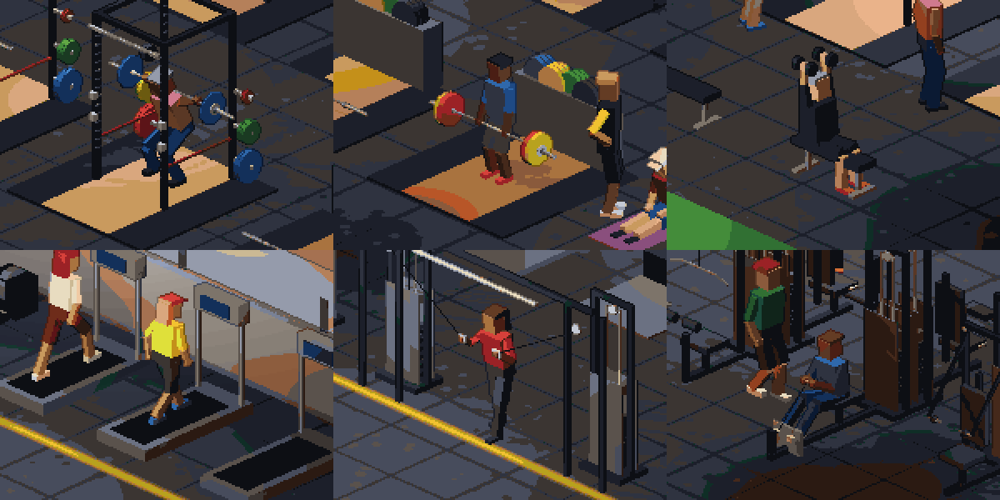
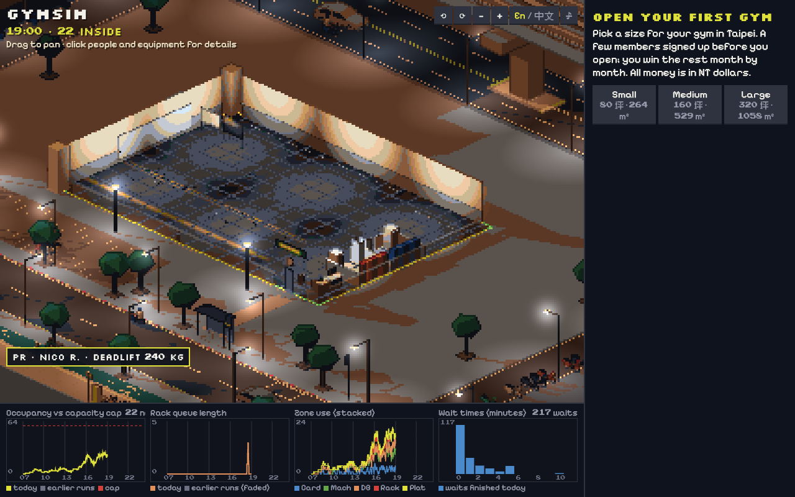
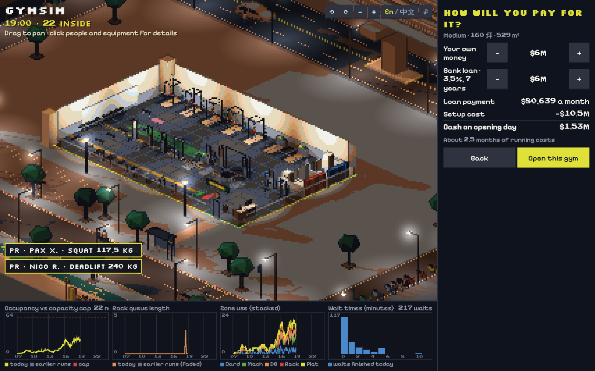
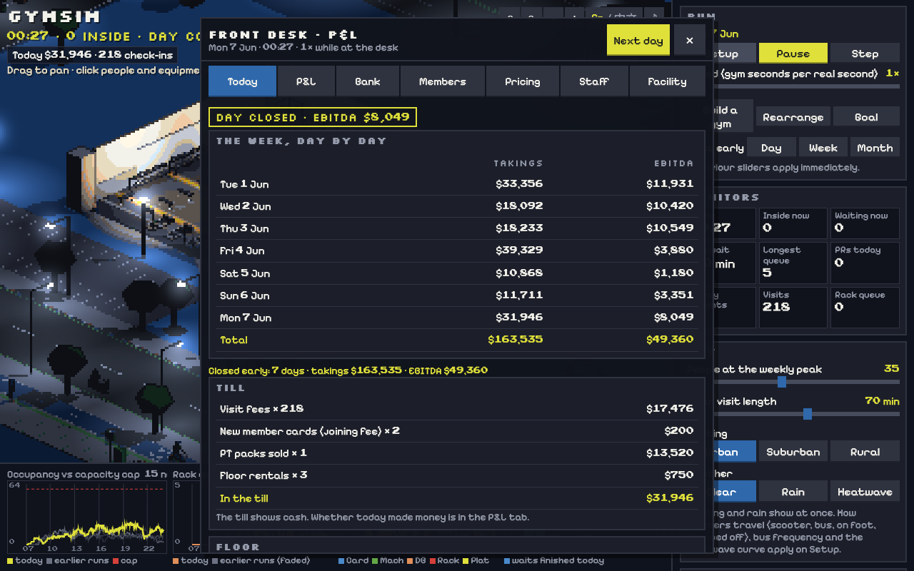
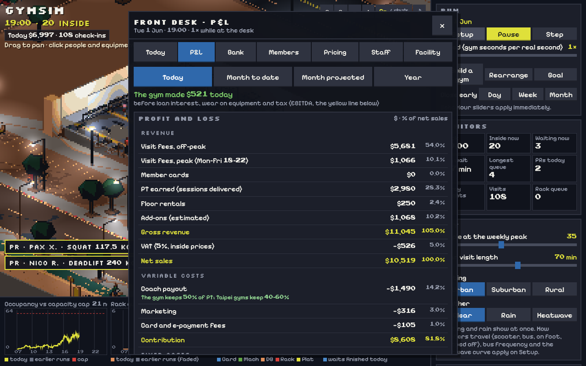
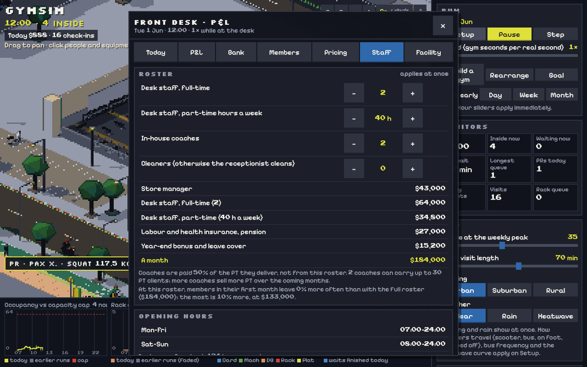
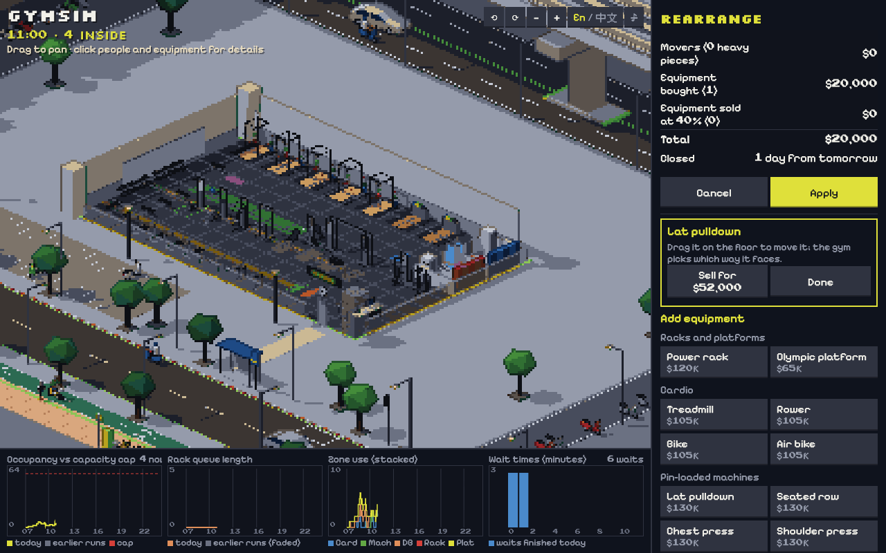
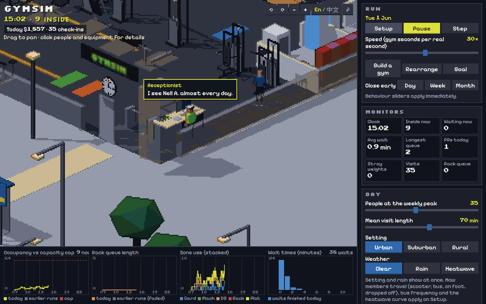

# GYM-SIM



A pixel-art isometric sandbox about running a strength gym, especially the money side. You build a gym in Taipei, open the doors and watch simulated members arrive, train and pay. Then you change something and see why the profit and loss moved.

**Play it in your browser: https://yyoyochen.github.io/gym-sim/**

It works on desktop and phones. The **En / 中文** button switches between English and Traditional Chinese. All money is in NT dollars.

## How to play

1. **Pick a size.** The game opens on the size screen: Small, Medium or Large. You see the setup cost for each.
2. **Pay for it.** Decide how much is your own money and how much is a bank loan. You can open overdrawn; the figure shows in orange.
3. **Open the doors.** The gym starts with the members who signed up before opening. The camera follows the first member in, who goes straight to a squat.
4. **Pick a goal, or skip.** A card offers a goal, such as reaching 500 members by the end of month 3. Its progress shows under the clock.
5. **Run time.** Start the day, speed it up, or close the day, week or month early. Days run on into months, so you pay real monthly rent, payroll and loan instalments.
6. **Tap the front desk** to open the P&L, change something, and watch what it does.

Progress is saved in your browser. A reload carries on from the morning of the current day. **Build a gym** starts a new one.

<p> </p>

## What you manage

### The P&L

Tap the counter at the front desk. The tabs are:

- **Today** and **P&L**: revenue, costs and profit for today, the month so far, the projected month and the year.
- **Bank**: cash, the loan balance and its payments, and equipment bought and sold.
- **Members**: who is likely to quit, and what you can try (a message, a PT taster, a voucher or a win-back SMS), each with its cost and chance of working.
- **Pricing**: off-peak and peak prices per minute, the cap per visit, PT packs and the rental price for outside coaches. New prices apply from the next morning.
- **Staff**: full-time desk staff, part-time desk hours, in-house coaches and cleaners. Each coach carries up to 15 PT clients. Without a cleaner the receptionist cleans when it is quiet; a hired cleaner costs a wage but keeps bars stripped and dumbbells racked, and mess left lying around makes members' visits worse.
- **Facility**: floor area, rent, and the fire-code items that apply at larger sizes.

Closing early shows a summary. A week lists each day's takings and profit; a month lists the closed days by category.







### Rearrange

Press **Rearrange** to pause and see the gym as pieces on a grid. Drag a piece to move it, add equipment at its catalogue price, or sell a piece for 40% of its price. The sheet shows the cost and the days the gym will be closed before you apply. Cancel changes nothing.



### The people

- Tap a member to follow them and see what they are doing.
- Tap the receptionist for a line about the gym and its members. When it is quiet, they step out to clean.
- About a third of members come dressed and go straight to the floor. Some take a washroom break mid-workout.



## How the simulation works

- **Agents.** Each member is a small simulated person with their own strength, programme, patience and schedule. Queues and crowding are not scripted; they come from the numbers you set.
- **Billing.** Visits are charged per minute, with off-peak and peak prices and a cap per visit. PT packs, coach rentals, rent, staff, utilities, card fees, tax and loan interest all go into the P&L.
- **Growth.** A new gym starts small and grows month by month towards the area's demand.
- **Churn.** Members can lapse and return. Prices, crowding, long queues at the door, staffing and retention actions all change how many stay.
- **Weather.** Rain lowers visits; typhoon days close the gym.
- **Saved progress.** Each morning is saved in the browser. A reload replays the day from that morning, so changes made later in the day, such as a rearrange, are not kept.

The prices, costs and demand figures are a realistic starting point for Taipei. They are not a forecast for any real gym.

## Running it locally

The game is a single `index.html`. The sources are in `src/` and `build.py` joins them in file-name order into `shell.html`. It also embeds a subset of the Chinese pixel font.

```
pip install fonttools brotli   # needed by build.py
python3 build.py               # writes index.html
```

Open `index.html` in a browser to play.

Tests:

```
node --test 'tests/*.test.mjs'
```

The model tests run in Node. The self-tests open `index.html` in headless Chrome, so run `build.py` first. Set `CHROME` if Chrome is not at its usual macOS path.

## Changes

See [CHANGELOG.md](CHANGELOG.md). The newest changes are at the top.

## Credits

- Rendering: [three.js](https://threejs.org/) (MIT), loaded from a CDN.
- Chinese pixel font: [Cubic 11](https://github.com/ACh-K/Cubic-11) (free to use, copy and distribute; see `fonts/Cubic11-OFL.txt`).
- Latin pixel fonts: Silkscreen and Pixelify Sans, and Press Start 2P for digits (SIL Open Font License), from Google Fonts.

## License

MIT. See [LICENSE](LICENSE).
